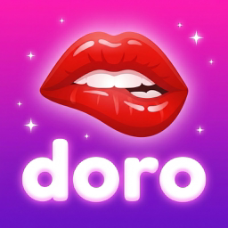
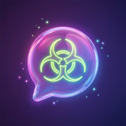
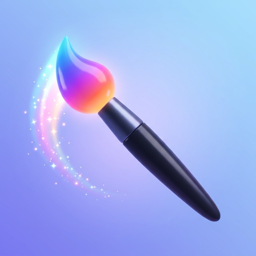
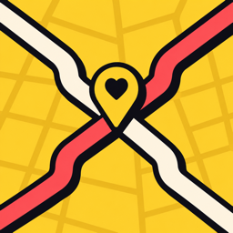
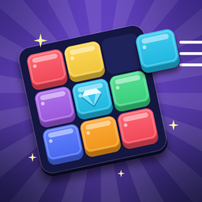

<a href="https://paulsoubigou.com"></a>

<p align="center">
  <a href="https://paulsoubigou.com"></a>
  <a href="https://www.linkedin.com/in/paul-soubigou/"></a>
  <a href="mailto:soubigoupaul@gmail.com"></a>
</p>

```console
$ whoami
Growth at Rocapine (paid, organic, AI creative) + solo iOS app studio.
Paris · Montréal · HEC Montréal · FR / EN / ES
```

### 🏆 Loot

| | |
|---|---|
| **$50K → $250K MRR** | scaled Unchaind at Rocapine |
| **$1M+** | ad spend run on my creatives (best ad alone: $197K) |
| **50M+** | organic views from two UGC creator programs |
| **0 → 70K** | YouTube subscribers for Unchaind |
| **Top 100 France** | my own apps, two months in a row |
| **2.5M** | followers on a French Instagram network I built (2021 to 2024) |

### 🚢 The fleet: apps I design, code and grow solo

<table>
  <tr>
    <td align="center" width="20%"><a href="https://apps.apple.com/app/id6760968832"><br><b>Doro</b></a><br><sub>AI dating coach. Screenshot a chat, get replies that land.</sub></td>
    <td align="center" width="20%"><a href="https://apps.apple.com/app/id6790562312"><br><b>Toxik AI</b></a><br><sub>Paste a convo, get a toxicity score and what to text back.</sub></td>
    <td align="center" width="20%"><a href="https://apps.apple.com/app/id6785551237"><br><b>DayDraw</b></a><br><sub>AI art that runs fully on the iPhone. Offline, private.</sub></td>
    <td align="center" width="20%"><a href="https://apps.apple.com/app/id6813341137"><br><b>Same Place</b></a><br><sub>Where a couple crossed paths before they met.</sub></td>
    <td align="center" width="20%"><a href="https://apps.apple.com/app/id6822487581"><br><b>Tilt Blocks</b></a><br><sub>Clear a line, tilt the board, chain cascades.</sub></td>
  </tr>
</table>

<sub>Native SwiftUI and SpriteKit · RevenueCat · Supabase · ASO in up to 50 languages. More puzzle games and a rank tracker on the way.</sub>

### 🧰 Inventory

**Build** &nbsp;


**Grow** &nbsp;


### 🗺️ Quest log

```diff
+ 2026  Own app studio      Doro, Toxik AI, DayDraw, Same Place, Tilt Blocks
+ 2026  Scrambly            UGC program, 2M+ organic views in 2 months
+ 2026  YIRL (Founders Inc) 400+ students at weekly meetups, SF + NY
+ 2025  Rocapine            Paid & organic growth, web-to-app funnels, KISS creative platform
+ 2025  Groover             €700K+ revenue driven, CPA -25%
+ 2025  AppTide             Founder, AI short-form video at scale
+ 2021  Instagram           2.5M-follower network, 10M impressions / week
```

<p align="center"><a href="https://paulsoubigou.com"></a></p>
